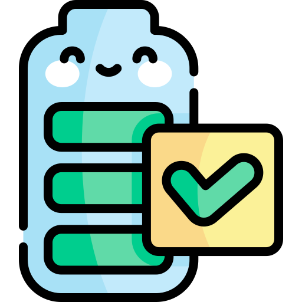

<h1 align="center">Alert Battery Full</h1>
<p align="center">
  
</p>

<p align="center">A lightweight, efficient, and customizable application designed for mobile Android systems. Its main purpose is to alert the user when the battery reaches a minimum and/or maximum level so they can connect or disconnect the charger.</p>

## 🚀 Key Features

* **Master Switch:** Easily turn the entire monitoring service ON or OFF with a single tap from the dynamic interface header.
* **Full Battery Alerte:** Triggers when reaching your custom percentage (e.g., 80% or 100%) **only while the device is charging**. The notification automatically dismisses itself when unplugging the charger.
* **Low Battery Alert:** Triggers when dropping to your custom percentage **only while the device is discharging**. The notification automatically clears as soon as you plug in the charging cable.
* **Privacy & Local Persistence:** All user settings are saved 100% locally using secure internal device storage (`SharedPreferences`).

## 🛠 Advanced Customization Options

Each alert type (high and low) features independent multimedia channels that can be toggled at will:
* **Visual Message:** Customizable notifications that travel natively to your **smartwatch** via the Android system.
* **Audio Beep:** Sound alerts with independent volume slider control.
* **Voice Text-to-Speech (TTS):** Customizable voice alerts ("*Battery fully charged. Unplug me, please*") with independent volume control.
* **Haptic Vibration:** Enabled or disabled according to your preference.

## 🧠 Intelligent Filters & Conditions

* **Respect System State:** Option to keep the app muted on Silent/Vibrate modes.
* **Wi-Fi Network Filter (SSID):** Restricts alerts to permitted comma-separated Wi-Fi networks (e.g., home Wi-Fi).
* **Background Resilience:** Includes battery optimization exclusion and `BootReceiver` for automatic restart after reboot.

## 📋 Requirements

* **Min. SDK:** Android API 26 (Android 8.0+)
* **Target SDK:** Android API 34 (Android 14)
* **Language:** Kotlin 1.9+
* **UI Toolkit:** Jetpack Compose con Material Design 3

## 📦 Installation via USB Cable (ADB)

To install the generated APK directly from your computer to your phone via cable, make sure you have **Developer Options** and **USB Debugging** enabled on your Android device, then follow these steps:

1. **Connect your device:** Plug your phone into your computer using a USB cable.
2. **Verify connection:** Open your terminal and run the following command to ensure your device is recognized:
   ```bash
   adb devices
   ```
3. **Install the APK:** Navigate to the folder where the APK was downloaded and execute:
   ```bash
   adb install AlertBatteryLevel.apk
   ```
   *(Note: If you are updating an existing installation, use `adb install -r AlertBatteryLevel.apk` to reinstall and keep your saved settings).*

## 👤 Personal Project Policy

This app is a **Personal Project**.

This means that this is something I created in my free time because I needed it myself, and I
decided to share it with the world.

If you like the app I'm happy to hear that! And if you have suggestions or if you find any bugs
please do let me know!

However, please be aware that you're not entitled to:

- Receiving support
- Having any bugs fixed
- Having any features added

If you would like to make the changes yourself, you're very welcome to send me a pull request.

## 🤝 Contributing

Contributions, issues, and feature requests are welcome! Feel free to check the issues page if you want to contribute.

## 📄 License

This project is licensed under the GNU General Public License v3.0 - see the LICENSE file for details.
